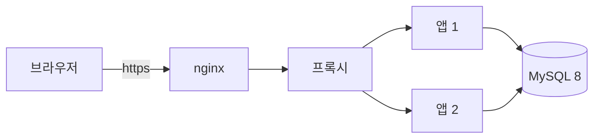

# JJ Blog

여러 사람이 함께 쓰는 **티스토리형 블로그 플랫폼**입니다. 회원은 메인블로그에 한 번 가입해서 자기 블로그를 만들거나 다른 사람의 블로그에 참여하고, 그 안에서 글을 쓰고 댓글·좋아요·팔로우로 소통합니다.

**운영 사이트**: https://jj-blog.java21.net

## 저장소

| 저장소 | 내용 |
| --- | --- |
| [blog-docs](https://github.com/blogJJ/blog-docs) | 기획·설계 문서. 요구사항분석서, DB 설계(ERD), Spec Kit 형식의 스펙·결정 기록·작업 목록 |
| [blog-server](https://github.com/blogJJ/blog-server) | 서버와 화면. Spring Boot 앱 하나가 REST API와 정적 화면을 함께 내려줌 |

## 무엇을 할 수 있나요

- **회원**: 이메일 인증 가입, 구글·깃허브 로그인, 계정 찾기, 탈퇴
- **블로그**: 블로그 만들기, 참여 신청·승인, 부블로그장 권한, 블로그장 위임, 폐쇄
- **글**: 마크다운 글쓰기, 카테고리·태그, 이미지 올리기(자동으로 줄여 WebP 저장), 글쓰기 도우미(태그 추천·맞춤법)
- **소통**: 댓글·좋아요, 팔로우·구독, 메인 피드, 통합 검색, 알림함
- **관리**: 신고 처리, 경고·정지, 공지, 통계. 새 댓글은 AI가 먼저 걸러 줌
- **꾸미기**: 블로그마다 픽셀 마스코트 30종과 대표 장면, 어두운 모드, 공유 미리보기 카드

블로그장·멤버는 따로 가입하는 계정이 아니라 회원이 블로그마다 갖는 역할입니다. 한 사람이 A 블로그에서는 블로그장, B 블로그에서는 멤버일 수 있습니다.

## 구성

- **서버**: Java 21, Spring Boot 4, Spring Security(JWT + HttpOnly 쿠키), JPA, Flyway, ShedLock
- **화면**: HTML + 바닐라 JS (서버가 함께 내려줌)
- **DB**: MySQL 8, 테이블 34개, 검색은 FULLTEXT ngram
- **AI**: Claude로 마스코트 고르기, 대표 그림, 글쓰기 도우미, 댓글 검사. 키가 없어도 대체 동작으로 돌아감
- **운영**: Docker, 앱 두 대 이중화와 한 대씩 바꾸는 무중단 배포, 매일 암호화 백업

## 만드는 방식

1. **요구사항 → 스펙**: 요구사항분석서를 [GitHub Spec Kit](https://github.com/github/spec-kit) 형식으로 정리합니다. 원칙(constitution), 스펙(spec), 결정 기록(D-번호), 데이터 모델, 작업 목록(T-번호)이 [blog-docs](https://github.com/blogJJ/blog-docs)에 있습니다.
2. **작업 → PR**: 작업은 T-번호 단위로 하고 Git Flow(feature → develop → release → main)로 합칩니다.
3. **검사**: PR마다 GitHub Actions가 빌드·테스트(Testcontainers로 진짜 MySQL)·마이그레이션 검사를 하고, SonarQube가 코드 품질과 커버리지를 봅니다.
4. **배포**: main에 합치면 자동으로 서버에 배포하고, 릴리즈 노트 버전으로 태그를 붙입니다. 바뀐 내용은 사이트의 [릴리즈 노트](https://jj-blog.java21.net/release-notes.html)에서 볼 수 있습니다.
